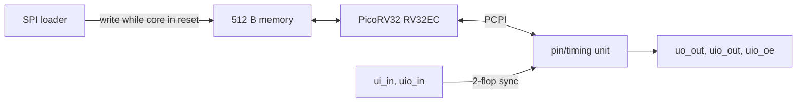

# PinV: a protocol emulator whose timing is proven

PinV is my entry for the Jane Street × Tiny Tapeout Protocol Emulator ASIC competition. It is a small RISC-V chip that speaks serial protocols in firmware. You write a protocol as an ordinary program, build it with the standard RISC-V GNU toolchain, and load it over SPI.

Most protocol emulators get their timing from testing. PinV gets it from proof. Before a program is loaded, a checker proves that it can never miss a deadline. The hardware contract that the checker relies on is proven formally. The security properties are proven too.

## Results

| | |
|---|---|
| Process | IHP 130 nm CMOS5L, 8x4 tiles, 40 MHz |
| Flow | GDS, precheck and gate-level tests pass in the Tiny Tapeout CI |
| Core | PicoRV32, RV32EC, unmodified |
| Memory | 512 bytes of program and data |
| Protocols demonstrated | UART, SPI modes 0-3, I2C, WS2812 LEDs, an SPI bus firewall |
| Programs | 119 to 472 bytes each, in assembly |
| Tests | 13 end-to-end tests, RTL and gate level |
| Formal proofs | pin/timing unit, non-interference, loader, top level |
| Mutation check | 15 injected bugs, 15 caught with a counterexample |
| Timing checker | 10 programs built to fool it, 10 refused |

## The problem

A protocol is a contract about time. A UART bit lasts exactly 1/115200 s. A WS2812 bit is high for 0.4 µs or 0.8 µs. If the edge comes late, the bit is wrong.

A small CPU is bad at time. PicoRV32 takes 3 to 6 cycles per instruction, and a shift by k bits takes 4 + k/4 + k%4 cycles. Counting cycles by hand works for one loop. It breaks as soon as the code changes.

So I asked a different question. Instead of making every instruction take a fixed time, can we make the edges independent of how long the instructions take?

## The idea: deadline-anchored I/O

Every timing-critical edge is placed on an absolute value of a free-running cycle counter.

```
WAIT_UNTIL(zero, t)     # release exactly when counter == t
PIN_OUT(zero, bit, m)   # the pin changes one cycle later
t += BIT_CYCLES         # next deadline, from the previous one
```

The edge lands on its deadline whatever the code before it did, as long as that code finished in time. Errors never add up, because each deadline comes from the previous deadline, not from "now".

That leaves one question: did the code finish in time? That is what PinV proves.

## Architecture



I reused PicoRV32 unmodified. It is mature and widely used, so my verification effort goes into what is new: the pin/timing unit, the loader, the programs.

The pin/timing unit adds 18 custom instructions through PicoRV32's coprocessor interface (PCPI). They are emitted with `.insn`, so no custom assembler is needed. The full table is in [architecture.md](architecture.md).

| Group | Instructions | What they do |
|---|---|---|
| Pins | `PIN_OUT`, `PIN_IN`, `PIN_DIR` | masked writes, synchronised reads, open-drain control |
| Time | `TIME`, `WAIT_UNTIL`, `WAIT_PIN` | read the counter, wait for a deadline, wait for a pin level and timestamp it |
| Timer | `SET_TIMER`, `WAIT_TICK` | an internal deadline that advances by a fixed step |
| Fused bits | `SHIFT_OUT(M)`, `SHIFT_IN(M)` | wait for the deadline, move one bit, shift the data, advance the deadline |
| Waveforms | `SET_WAVE`, `PULSE(M)` | one pulse per bit; the hardware places both edges |
| Security | `SET_LIMIT`, `LOCK`, `SET_IDLE` | bounded waits, program lock, safe pin state during a reload |

The fused instructions matter for speed. A UART bit went from 44 cycles to 18: one instruction does what four did.

`PULSE` matters for flexibility. It raises a pin at the deadline and drops it exactly t cycles later, with t chosen by the data bit. Protocols that encode bits as pulse widths (WS2812, IR remotes, 1-Wire-like lines) then cost one instruction per bit.

## Flexibility: protocols as programs

| Program | What it does | Proven speed at 40 MHz |
|---|---|---|---|
| `uart_echo.S` | UART TX and RX, echo | 18 cycles per bit minimum, about 2.2 Mbaud |
| `spi_jedec.S` | SPI master, modes 0-3, reads a flash ID | half period ≥ 77 cycles, about 260 kHz |
| `i2c_read.S` | I2C master, repeated START, clock stretching, NACK, stuck-bus timeout | about 160 kHz |
| `ws2812.S` | 4 RGB LEDs, colours rotate | bit period ≥ 39 cycles; WS2812 needs 50 |
| `spi_firewall.S` | SPI bus firewall between a host and its flash | host clock ≤ 33 kHz |

The firewall came after the design was done, and needed no hardware change. WS2812 needed one new instruction, `PULSE`, which serves every pulse-width code, not just this one; the demo itself is 128 bytes. That is the test of flexibility I care about: a new protocol is a new program, not a new chip.

The firewall is the demo I find most interesting. PinV sits between a microcontroller and the flash that holds its firmware. Reads go through. Write enable, page program and erase are dropped before the flash sees a single bit, and logged on the UART. The firewall locks itself, so a compromised host cannot reload PinV to remove it. It keeps the flash deselected during a reload, and it bounds every wait, so a host that stops mid-byte cannot hang it.

## Verification

I verified PinV in four layers. Each layer checks something the others cannot.

### 1. Every program is proven before it is loaded

`tools/pinv_check.py` is a static worst-case timing checker for PinV programs.

1. It rebuilds the control-flow graph of the code reachable from address 0. It accepts a return only in one form: `jalr x0, 0(rs)`, inside a function always called with `jal rs`, that never writes rs. Every other indirect jump is refused, and so is a jump outside the program.
2. It computes each deadline from the code, as "anchor time + constant" on every path. A deadline it cannot pin down is refused.
3. For every anchor, it explores every path to the next deadline and computes the worst-case cycle count. Any path that can exceed the deadline, or any unbounded loop in between, is refused.
4. It reports the deadlines found, analysed and not covered, and says `PROVEN` only if at least one was analysed and nothing was refused.
5. It proves the exact bytes that will be loaded, refuses any store that could overwrite them, and writes a certificate with their SHA-256. Nothing is loaded without it.

The cost model comes from the RTL. I generated benchmark programs for every instruction class, ran them in simulation and measured them (`tools/timing/`). Then I validated the whole model on each demo: at the smallest budget the checker accepts, the simulation shows no missed deadline. One cycle less, it shows a miss.

The firmware build runs the checker. If a deadline can be missed, no binary is produced.

It found a real bug on day one. The SPI demo asked for 48-cycle half periods. One path through the bit loop takes 77. SPI is clocked by the master, so the tests still passed, at a slower clock than requested. Tests could not see it. The checker did.

The checker had holes of its own. A review showed that the first version trusted the budget the programmer declared instead of the deadline the code computed, took any indirect jump for a return, ignored jumps outside the program, and printed `PROVEN` even when it had checked nothing. I wrote ten programs that each exploit one hole (`tools/check_tests/`). The first version accepted nine of them. The current one refuses all ten, and CI runs them on every commit. The demos still pass with the same worst cases as before, so the RTL calibration still holds.

### 2. The hardware contract is proven formally

The checker assumes the hardware keeps its promises: `WAIT_UNTIL` releases exactly at the deadline, `PIN_OUT` changes exactly the masked bits, and so on. I proved those promises with SymbiYosys and the Yices solver, by k-induction. A proof covers every reachable state and every input sequence, not just the cases a test happens to run.

What is proven, in short:

- **Zero jitter.** A wait whose deadline is in the future releases exactly when the counter equals it.
- **Exact outputs.** `PIN_OUT` changes exactly the masked bits, one cycle later. Nothing else changes the outputs, except the falling edge of a pulse.
- **Exact pulses.** A `PULSE` lasts exactly t cycles. Its falling edge is never lost, whatever instruction runs meanwhile.
- **No drift.** The internal deadline advances by exactly one step per bit instruction, and only `SET_TIMER` sets it.
- **Bounded waits.** A limited `WAIT_PIN` never waits longer than its limit, whatever the pins do.
- **Non-interference.** Two copies of the unit, fed the same instructions but arbitrary different data, answer at the same cycles forever. When a bit leaves the chip does not depend on its value. (`PULSE` is the deliberate exception: there, the width is the data.)
- **Safe loading.** The loader never writes memory while the core runs. The core never runs before a program is loaded. Once locked, the LOAD pin has no effect until reset.

### 3. The proofs are tested too

A proof that passes is only worth something if it can fail. So I injected bugs on purpose: a release one cycle early, an ignored mask, a deadline that depends on the data, a bypassed lock, a pulse that falls one cycle early, and ten more. Each one makes the proof fail, with a concrete counterexample trace.

This caught a bug in a proof. One of my properties was always true: in Verilog, `==` binds tighter than `|`, so the assertion compared the wrong things. An injected bug passed, which exposed it.

### 4. End-to-end tests, at RTL and gate level

Thirteen cocotb tests load real binaries through the SPI loader and check the pins against simulated devices: a UART terminal, an SPI flash in four modes, an I2C device with clock stretching, a WS2812 decoder, a host attacking its flash. A monitor fails any test where a deadline is missed. The same tests run on the gate-level netlist in CI.

### What each layer caught

| Bug | Found by | Missed by |
|---|---|---|
| SPI demo slower than requested (77 vs 48 cycles) | timing checker | tests (the master clocks the bus) |
| Core running random memory at power-up, which could execute `LOCK` and brick the chip until reset | gate-level simulation | RTL tests (simulators give registers a value; silicon does not) |
| A one-cycle reset, exactly during `LOCK`, locking a chip with no program | formal proof (top level) | every test |
| A property that could never fail | mutation check | the proof itself |
| A checker that accepted 9 of 10 programs built to fool it | external review, then trap programs | the demos (all correct, so they never hit the holes) |
| Synthesis using two I/O pads as buffers, unplaceable in a tile | comparing cell lists between a passing and a failing GDS run | — |

Each layer caught something the others missed. That is the main lesson of the project.

## Security

| Threat | Defence | Status |
|---|---|---|
| A device holds a line low forever | `SET_LIMIT` bounds `WAIT_PIN`; a sticky flag reports it | proven; tested on a stuck I2C bus |
| Someone replaces or halts the program from outside | `LOCK`: LOAD is ignored until reset | proven; tested |
| Code injection while running | the loader writes only while the core is in reset | proven |
| Control lines glitch during a reload | `SET_IDLE` | proven; tested |
| Timing side channel on the pins | deadline-anchored I/O | proven (non-interference) |
| A host sends write or erase commands to its flash | `spi_firewall.S` | tested |

Out of scope: physical attacks (glitching, fault injection, power analysis), PicoRV32 itself (reused, not re-proven), properties I did not think of, and protocol-level loss (the UART echo cannot receive while it transmits).

## Physical design

The full Tiny Tapeout flow passes at 40 MHz. The first attempt at 50 MHz failed setup timing in the slow corner (1.08 V, 125 °C), so I lowered the clock.

Most of the area is memory. 512 bytes of flip-flops is 4,096 bits out of 5,293 flip-flops, and they need about 5,000 hold-delay cells. A latch-based memory is the obvious next step.

One flow bug is worth sharing. After a small RTL change, placement failed on a single instance. Changing densities did nothing. Comparing the synthesised cell lists of the last good run and the first bad one showed two I/O pad cells: the synthesis tool had picked them as strong buffers. One line in `config.json` excludes them.

## Limitations

- Single-threaded: one protocol at a time.
- 512 bytes: enough for assembly, tight for C.
- I2C reaches about 160 kHz, not 400 kHz.
- The SPI firewall mirrors the bus in software, so the host clock stays below 33 kHz.
- `PULSE` drives one pulse at a time.

## Tools

- RTL: Verilog. Core: PicoRV32 (ISC license).
- Firmware: RISC-V GNU toolchain; instructions emitted with `.insn` macros (`firmware/pinv.h`).
- Simulation: Icarus Verilog and cocotb; gate level with the IHP cell models.
- Formal: SymbiYosys, Yosys, Yices.
- Timing proof: `pinv_check.py`, my own tool, about 780 lines of Python, with its own test suite of trap programs.
- Flow: Tiny Tapeout IHP template, LibreLane, GitHub Actions.

### AI tools

I am not a professional chip designer. I built PinV with Claude (Anthropic), used as a pair programmer in Claude Code. It wrote most of the RTL, the tests, the proofs, the checker and the first drafts of the documentation. I set the direction, made the design choices and reviewed the results.

AI output is cheap to produce and easy to get wrong, so I did not take any of it on trust. That is one reason the verification is in four layers. Every claim in this document is backed by something that runs in CI: a proof, a test or the checker. Several bugs in AI-written code were caught that way, including the always-true property above.

## Reproduce

```
make -C firmware            # build every demo; fails if a deadline can be missed
make -C test                # end-to-end tests (cocotb, Icarus)
make -C formal              # every formal proof (SymbiYosys, Yices)
```

Repository: https://github.com/Edoouuard/protocol-emulator-ASIC. A day-by-day journal of the design, in French, is in [journal.md](journal.md).
